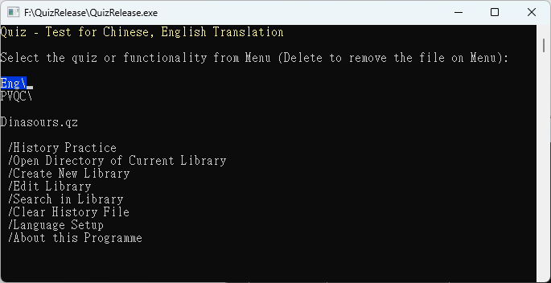

# Bill English Vocabulary Quiz Program

A console-based self-improvement quiz programme for practicing English vocabulary, built for macOS and
Ubuntu in C++.

Written by Bill Tsou (National Ilan University) in 2018 to help study for PVQC, and updated
since January 2026 with a directory-based vocabulary library system. The original Windows version is
kept on the `master` branch.

## Features

- Interactive vocabulary quizzes: type the answer letter-by-letter with live feedback, choose how many
  questions to attempt each round.
- Vocabulary libraries organized as a browsable folder tree under `database/`.
- Search across every library file in `database/` for a keyword (English or Chinese) and optionally
  save the results as a new library.
- Create and edit libraries directly (opens TextEdit on macOS or the default text editor on Ubuntu, then
  converts the `.txt` draft into a `.qz` library).
- Automatic history tracking: wrong answers are saved to `[History].qzc` and can be re-practiced later.
- Traditional Chinese / English UI, switchable from the in-programme menu.

## Requirements

The console menu uses POSIX `termios` and ANSI escape codes (no extra library), and the "About" window
uses GTK3.

- **macOS**: Xcode Command Line Tools and GTK3 from [Homebrew](https://brew.sh):
  ```sh
  xcode-select --install
  brew install gtk+3 pkg-config
  ```
- **Ubuntu**:
  ```sh
  sudo apt install build-essential pkg-config libgtk-3-dev
  ```

## Project Structure

| Filename | Description |
| --- | --- |
| `QuizRelease.cpp` | Program entry point / main menu loop |
| `QuizCommon.h`/`.cpp` | Shared logic: menus, file I/O, quiz flow, search, history |
| `Menu.h`/`.cpp` | Console menu widget (arrow-key navigation, colours) and terminal helpers |
| `CreativeCommons.h`/`.cpp` | "About" window (GTK3 + `CreativeCommons.png`) |
| `database/` | Vocabulary libraries (`*.qz`), organized in sub-folders |
| `compile.sh` | Build / clean helper script |
| `[Quiz].set` | Saved UI language setting (auto-created) |
| `[History].qzc` | Saved history of incorrectly-answered questions (auto-created) |

## Compiling

Use the included `compile.sh` from a terminal in the project root:

```sh
./compile.sh compile
```

This compiles all source files with `c++` (clang++ on macOS, g++ on Ubuntu; override with `CXX=...`) and
produces `QuizRelease` in the project root. Intermediate `.o` files are left in place after a build.

## Cleaning

```sh
./compile.sh clean
```

Removes the intermediate `.o` files produced by `./compile.sh compile`, without touching `QuizRelease`.

## Running

Run the built executable from the project root (it reads/writes `database/`, `[Quiz].set`, and
`[History].qzc` relative to the current directory):

```sh
./QuizRelease
```

Navigate the menu with the arrow keys and Enter; press `Delete` (`fn` + `Backspace` on a Mac keyboard)
on a library file to remove it from the menu, and `Esc` to leave the programme. The first run will set
up `database/` and `[Quiz].set` automatically if they don't already exist.

The menu is drawn at absolute positions of the terminal, so keep the terminal window taller than the
menu. When no graphical display is available (e.g. over SSH), the "About" licence is shown in the
terminal instead of a window.

Demo screenshot of Quiz program



## Library File Format

Each library is a plain-text UTF-8 `.qz` file under `database/` (in any sub-folder), one vocabulary
entry per line, in the form:

```
english_word=chinese_definition
```

For example:

```
appointment=n.約會，約定
calendar=n.日曆/月曆/行事曆
```

Libraries can be created/edited from the in-programme menu (`Create New Library` / `Edit Library`), which
opens the file in a text editor and converts it back into `.qz` format automatically:

- **macOS**: the file opens in TextEdit; save it and quit TextEdit (`Cmd+Q`) to continue.
- **Ubuntu**: the file opens in the default text editor (`xdg-open`); save and close it, then press any
  key in the terminal to continue.

## Developer References

`ChangeColour` still takes the Windows console colour codes (`background << 4 | foreground`) and converts
them to ANSI escape codes. Refer to the following picture for the colour codes.


